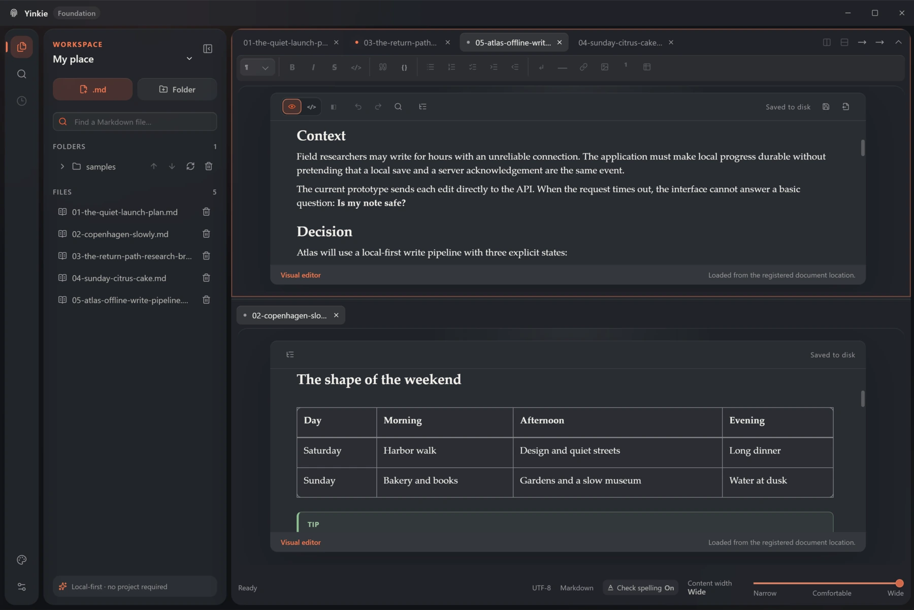
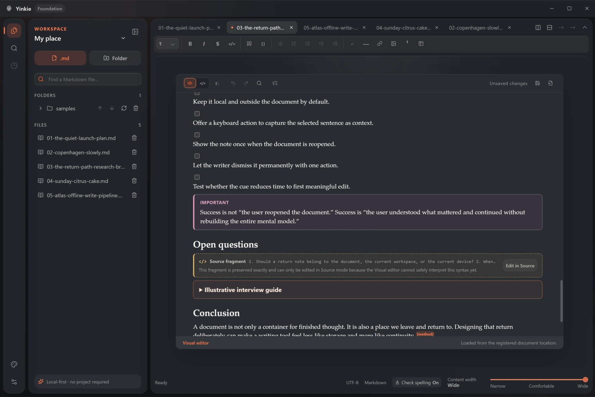
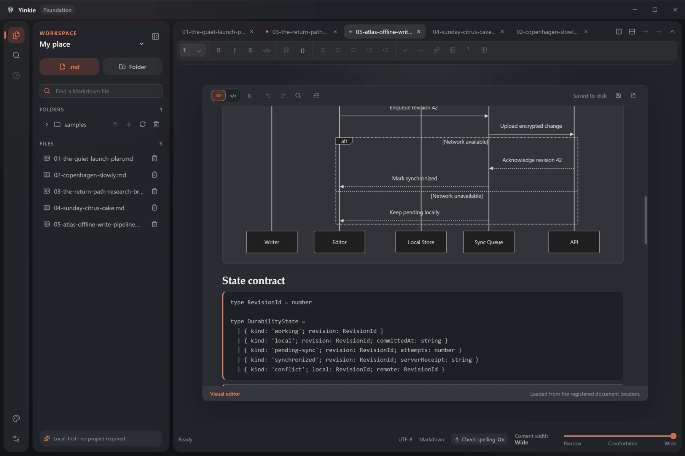

  

<h1 align="center">Yinkie</h1>

  <strong>A calm visual Markdown editor for files that stay yours.</strong>

  Write visually. Switch to source when you need precision. 
  Keep clean, portable <code>.md</code> files — always.

  <a href="https://yinkie.com"><strong>Website</strong></a>
  &nbsp;&middot;&nbsp;
  <a href="https://yinkie.app"><strong>Open the web editor</strong></a>
  &nbsp;&middot;&nbsp;
  <a href="https://github.com/TrinkieYinkie/Yinkie_releases/releases/latest"><strong>Download Yinkie</strong></a>

  
  
  
  

  

## Markdown, without the markup getting in your way

Yinkie gives ordinary Markdown documents a polished writing surface. There is
no proprietary project format and no database between you and your words — just
files you can open in Yinkie, a code editor, or any other Markdown app.

Use **Visual** mode when you want to focus on writing. Open **Source** when exact
syntax matters. Turn on **Preview** beside your source to see the result as you
work. Every view follows the same document; Yinkie does not create competing
copies of your text.

<table>
  <tr>
    <td width="50%" valign="top">
      <h3>Files that stay yours</h3>
      
Work with ordinary <code>.md</code> files. Your writing remains readable,
      portable and useful without Yinkie.

    </td>
    <td width="50%" valign="top">
      <h3>Visual when you want it</h3>
      
Format headings, lists, links, tables, images, footnotes and more without
      having to think in punctuation.

    </td>
  </tr>
  <tr>
    <td width="50%" valign="top">
      <h3>Local-first by default</h3>
      
No account is required for editing. Yinkie works directly with local
      documents instead of turning them into cloud-only content.

    </td>
    <td width="50%" valign="top">
      <h3>A real desktop workspace</h3>
      
Bring together independent files and folders, keep multiple documents
      open, split the editor and search across your Markdown workspace.

    </td>
  </tr>
</table>

## A useful home for AI-assisted Markdown

Ask your AI assistant for a plan, research summary or documentation in Markdown.
Save the result as a .md file and open it in Yinkie to read, revise and keep it
alongside your own notes. On Desktop, multiple folders and documents can share
one workspace, with tabs and two editor groups keeping references close at hand.

AI generation happens in your chosen service. Yinkie works with the Markdown
you bring into it.

## One document, two ways to think

Source is never treated as a lesser mode. Yinkie is designed to preserve
Markdown it cannot safely edit visually instead of silently flattening or
discarding it. When a fragment cannot be interpreted safely, it stays visible
and points back to the exact Source that owns it.

  

## More than a single-file editor

Yinkie Desktop is made for people whose notes, documentation and writing live
across real folders. Named workspaces can combine multiple roots and pinned
files without moving them or imposing a project structure. Quick Open and
workspace search help you move through a large collection without losing the
calm writing surface.

Rich technical documents belong in that same workflow. Supported diagram
fences render as bounded previews, while code remains readable and close to its
plain Markdown source.

  

## Desktop and Web

Yinkie uses the same Markdown engine across both experiences, while staying
honest about what a browser can and cannot do.

| | Yinkie Desktop | Yinkie Web |
| --- | --- | --- |
| Visual and Source editing | Yes | Yes |
| Source with read-only Preview | Yes | Yes |
| Open and save local Markdown | Native file access | Browser-permitted file access |
| Tabs and split editor | Yes | Yes |
| Folder workspaces and workspace search | Yes | — |
| File watching and conflict handling | Yes | Limited by the browser |
| Account required | No | No |
| Document upload required | No | No |

Open the browser edition at **[yinkie.app](https://yinkie.app)**. Your Markdown
file is opened on your device; it is not uploaded merely to use the editor.

## Download

Get the newest desktop build from **[Latest Release][latest-release]**.

| Platform | What to download |
| --- | --- |
| Windows | The installer ending in `.exe` |
| macOS | The disk image ending in `.dmg` |

Each release page includes the version, attached installers, known limitations
and a readable summary of what changed.

> [!IMPORTANT]
> Early Yinkie Desktop builds may be unsigned. Windows may display a Microsoft
> Defender SmartScreen warning, and macOS may require manual approval in
> **System Settings → Privacy & Security**. Download Yinkie only from this
> repository or from links on [yinkie.com](https://yinkie.com).

## Choose Markdown that fits your other tools

Yinkie supports these document compatibility profiles:

- **Yinkie Markdown 5.0**
- **CommonMark 0.31.2**
- **GitHub Flavored Markdown (GFM) 0.29**
- **GitHub repository Markdown**, reviewed 2026-08-27, for repository .md files

Choose the profile your other editor or destination supports. Yinkie checks the
document against that profile and identifies syntax/structure outside its
contract. You can change an individual document's target or set a default for
new files. Changing the target does not silently rewrite the document.

Compatibility does not imply identical visual styling or support for every
third-party extension. The GitHub profile covers repository Markdown files,
not every GitHub surface.

## Markdown support

Yinkie is built around portable Markdown and a conservative approach to
round-trip editing.

<strong>See supported content</strong>

 

- headings, paragraphs and thematic breaks;
- bold, italic, strikethrough and inline code;
- ordered, unordered and task lists;
- links and images;
- blockquotes and fenced code blocks;
- GitHub-style tables and alerts;
- footnotes;
- reviewed safe HTML and details blocks;
- frontmatter preservation;
- Mermaid and other supported diagram fences;
- document outline, Find/Replace and spellcheck.

When a construct cannot be represented safely in Visual mode, Yinkie keeps
Source available rather than pretending the syntax does not exist.

## Privacy is part of the product

Your documents are not marketing data.

- Local editing does not require an account.
- The web editor does not need to upload your Markdown document.
- Remote content is not loaded from a document without explicit permission.
- Document text, filenames, paths and search queries do not belong in product
  analytics.

The application and its main functionality remain free on both Desktop and Web.
This is not a trial. Optional paid additions may appear later. Accounts,
synchronization and other online services are not available yet; if introduced,
they may have separate pricing without changing the free-core promise.

## Feedback

Public support: **[support@yinkie.com](mailto:support@yinkie.com)**.

Yinkie is growing in public, and thoughtful reports are especially valuable
during the early releases.

Before opening an issue, please check whether it has already been reported. For
a new report, include:

- your Yinkie version and operating system;
- the smallest set of steps that reproduces the problem;
- what you expected and what happened instead;
- a screenshot, when it helps explain the interface state.

Please do not attach private documents. If Markdown content is needed to
reproduce a problem, replace it with a short fictional example first.

**[Report a problem or suggest an improvement][new-issue]**

## About this repository

This is Yinkie's public distribution repository. It contains the landing page,
official release binaries, release notes and public issue tracking. The application source code
is maintained separately.

  <a href="https://yinkie.com">yinkie.com</a>
  &nbsp;&middot;&nbsp;
  <a href="https://yinkie.app">yinkie.app</a>
  &nbsp;&middot;&nbsp;
  <a href="https://github.com/TrinkieYinkie/Yinkie_releases/releases">all releases</a>

  Made for people who want beautiful writing tools without giving up plain text.

[latest-release]: https://github.com/TrinkieYinkie/Yinkie_releases/releases/latest
[new-issue]: https://github.com/TrinkieYinkie/Yinkie_releases/issues/new/choose

## Landing development

See [local development](docs/landing.md), the [landing plan](docs/plans/yinkie-landing.md),
and the [screenshot brief](docs/screenshots.md).

[Landing analytics](docs/landing-analytics.md) measures page views and Desktop-link
intent using only in-memory page IDs and closed source/campaign categories. It is
separate from application telemetry and download counters. Production sending
is disabled until the dedicated receiver is ready.
