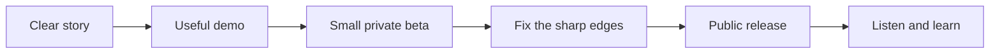

# The Quiet Launch

*A launch plan for a small product with a clear promise and no borrowed noise.*

> [!IMPORTANT]
> The goal is not to be everywhere on launch day. The goal is to help the first
> one hundred people understand the product, try it, and know why they might
> return.

## At a glance

| Signal | Target | How we will know |
| :--- | ---: | :--- |
| First-week visitors | 2,000 | Privacy-safe aggregate count |
| Meaningful first sessions | 300 | A core action is completed |
| Helpful conversations | 25 | Replies with a concrete use case |
| Critical failures | 0 | No data-loss or blocked-download reports |

## The story in one breath

**For people who want a calmer way to shape their ideas**, the product turns a
messy first draft into a clear working document. It is fast enough for a note,
structured enough for a plan, and quiet enough for a long afternoon of writing.

> We are not launching a list of features. We are launching a better feeling:
> *I know where my work is, and I know what to do next.*

## Path to launch

## Milestones

### 1. Make the promise believable

- [x] Write the one-sentence product promise.
- [x] Choose three workflows for the first demo.
- [ ] Record a sixty-second walkthrough.
- [ ] Ask five new users to describe the product back to us.

> [!TIP]
> If people repeat the feature list but cannot explain the benefit, the story is
> not ready yet.

### 2. Prepare a kind first experience

- [ ] Create one beautiful sample document.
- [ ] Replace empty states with a useful next action.
- [ ] Test the download from a completely new machine.
- [ ] Write the privacy explanation in plain language.
- [ ] Make recovery steps easy to find.

### 3. Invite the first circle

| Group | What they need | Invitation |
| :--- | :--- | :--- |
| Curious writers | A reason to try it today | Short personal note |
| Documentation teams | Confidence in the file format | Workflow demo |
| Markdown enthusiasts | Evidence of careful handling | Technical note |
| Friends of the project | A simple way to help | Share one honest link |

## Launch-day rhythm

1. **09:00 — Verify.** Download every public artifact and open the web edition.
2. **10:00 — Publish.** Make the release notes and landing page visible.
3. **11:00 — Invite.** Send the first small batch of personal messages.
4. **13:00 — Observe.** Watch for confusion, not vanity metrics.
5. **16:00 — Respond.** Fix urgent blockers and answer thoughtful questions.
6. **18:00 — Pause.** Write down what happened before changing the plan.

> [!WARNING]
> Do not ship a hurried fix directly from a support conversation. Reproduce the
> problem, protect the user's work, and make the smallest safe change.

## Message kit

### Short description

> A calm writing tool for documents that remain simple, portable, and yours.

### Launch post

Today we are releasing the first public version. It is intentionally focused:
one clear workflow, thoughtful defaults, and files that never become trapped in
the product. Try it with something real, then tell us where the experience
stops feeling effortless.

Definition of a successful first week

The launch is successful if:

- new users can begin without a call or tutorial;
- the core workflow feels complete rather than merely possible;
- feedback contains real stories, not only feature requests;
- no one loses work;
- the team still has enough energy to make a careful second release.

## Questions for the retrospective

- Where did people hesitate?
- Which phrase made the value easiest to understand?
- What did users try that we did not anticipate?
- Which problem appeared urgent but affected almost no one?
- What is the smallest improvement that would make the next session better?

The answers belong in the next plan — not in a forgotten analytics tab.[^signal]

[^signal]: A useful signal changes a decision. If a number cannot change what
    we do, it is probably decoration rather than evidence.
