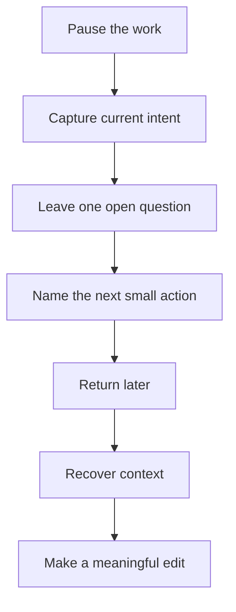

# The Return Path

## A research brief on finding context after interruption

> [!NOTE]
> This is an illustrative research document. The participants, quotes, and
> measurements below are fictional and exist to demonstrate a polished working
> brief.

## Executive summary

People rarely struggle to reopen a document. They struggle to recover the
mental state that made the document meaningful.

In this small illustrative study, the fastest returns happened when a document
contained three things near the point of departure:

1. a visible statement of intent;
2. an unresolved question;
3. a concrete next action small enough to begin immediately.

The implication is simple: **tools should preserve the return path, not merely
the last cursor position**.

## Study snapshot

| Dimension | Illustrative setup |
| :--- | :--- |
| Participants | 12 people working with long-form documents |
| Sessions | 3 interrupted writing sessions per participant |
| Return window | 2 hours to 3 days |
| Material | Notes, specifications, essays, and plans |
| Primary measure | Time to the first meaningful edit |

## What we observed

### 1. Position is not context

Returning to the exact line helped only when the surrounding paragraph still
made the writer's intention obvious. A cursor can remember *where* someone
stopped; it cannot remember *why*.

> “I was back in the right sentence, but I had no idea what decision I was
> trying to make.” — Participant 07

### 2. Small open loops are useful

An unfinished question created a stronger return cue than a polished closing
sentence. Writers resumed more quickly when they had left themselves a bounded
piece of thinking to complete.

> [!TIP]
> Before leaving a document, write one sentence beginning with **Next, decide…**

### 3. Too much history becomes another task

Participants valued recent changes when the comparison answered a specific
question. A long undifferentiated timeline made them feel responsible for
reviewing everything.

| Return cue | Typical response | Confidence |
| :--- | :--- | :---: |
| Last cursor position | “I recognize this place.” | Medium |
| Highlighted unresolved question | “I know what I was thinking about.” | High |
| Concrete next action | “I can start now.” | High |
| Full activity timeline | “Do I need to read all of this?” | Low |

## A model for resumable documents

## Design principles

- **Keep the document primary.** Resumption cues should support the writing,
  not turn it into a project-management system.
- **Prefer a small signal near the work.** Context at the relevant paragraph is
  more useful than a distant dashboard.
- **Separate recovery from history.** Restoring unsaved work and reviewing past
  versions solve different emotional problems.[^recovery]
- **Make the cue disposable.** Once the writer has resumed, the reminder should
  be easy to remove.
- **Do not infer private intent.** A writing tool should not send document text
  elsewhere to guess what matters.

## Recommended prototype

- [ ] Add a lightweight “return note” beside the active document.
- [ ] Keep it local and outside the document by default.
- [ ] Offer a keyboard action to capture the selected sentence as context.
- [ ] Show the note once when the document is reopened.
- [ ] Let the writer dismiss it permanently with one action.
- [ ] Test whether the cue reduces time to first meaningful edit.

> [!IMPORTANT]
> Success is not “the user reopened the document.” Success is “the user
> understood what mattered and continued without rebuilding the entire mental
> model.”

## Open questions

1. Should a return note belong to the document, the current workspace, or the
   current device?
2. When does a helpful reminder become distracting metadata?
3. Can a short manual cue outperform an automatically generated summary?
4. How should the experience behave when the underlying file changes elsewhere?

Illustrative interview guide

1. What were you trying to accomplish when you stopped?
2. What was the first thing you looked for when you returned?
3. Which information helped you trust that you were in the right place?
4. What did you have to reconstruct from memory?
5. What could the tool have preserved without getting in your way?

## Conclusion

A document is not only a container for finished thought. It is also a place we
leave and return to. Designing that return deliberately can make a writing tool
feel less like storage and more like continuity.[^method]

[^recovery]: Recovery answers “Is my work safe?” History answers “What changed?”
    A return cue answers a third question: “What was I trying to do?”

[^method]: In a real study, the sample, protocol, raw observations, exclusions,
    and analysis method would be documented separately.
