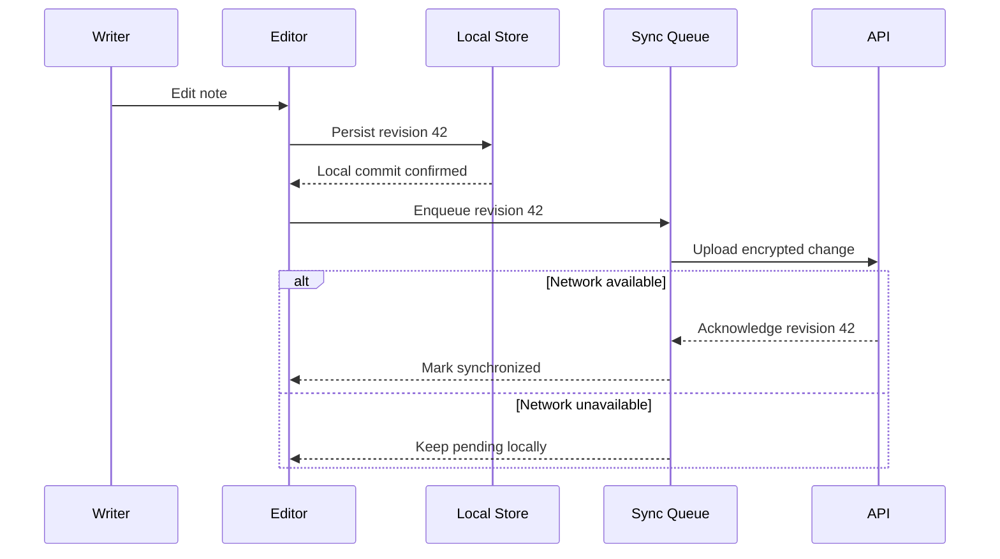

+++
title = "Atlas Offline Write Pipeline"
status = "accepted"
decision = 12
owners = ["Client Platform", "Data Integrity"]
+++

# ADR-012: Atlas Offline Write Pipeline

**Status:** Accepted<br>
**Scope:** Fictional field-notes application<br>
**Primary quality:** A confirmed save must survive loss of network access

> [!NOTE]
> Atlas is a fictional product used to demonstrate a technical design document.
> The architecture below is intentionally compact rather than production-ready.

## Context

Field researchers may write for hours with an unreliable connection. The
application must make local progress durable without pretending that a local
save and a server acknowledgement are the same event.

The current prototype sends each edit directly to the API. When the request
times out, the interface cannot answer a basic question: **Is my note safe?**

## Decision

Atlas will use a local-first write pipeline with three explicit states:

1. **Working** — the editor contains a newer in-memory revision.
2. **Saved locally** — the revision is durably recorded on the device.
3. **Synchronized** — the server has acknowledged that exact revision.

The interface may summarize these states, but the storage layer must never
collapse them into one boolean.

## Sequence



## State contract

```typescript
type RevisionId = number

type DurabilityState =
  | { kind: 'working'; revision: RevisionId }
  | { kind: 'local'; revision: RevisionId; committedAt: string }
  | { kind: 'pending-sync'; revision: RevisionId; attempts: number }
  | { kind: 'synchronized'; revision: RevisionId; serverReceipt: string }
  | { kind: 'conflict'; local: RevisionId; remote: RevisionId }
```

> [!IMPORTANT]
> Only the local store may confirm **Saved locally**. A queued operation, an
> optimistic UI update, or a successful serialization is not a durable save.

## Decision matrix

| Situation | Local editing | Queue behavior | User message |
| :--- | :---: | :--- | :--- |
| API healthy | Continue | Upload in order | Saved and synchronized |
| Network offline | Continue | Retain locally | Saved on this device |
| Authentication expired | Continue | Pause and preserve | Saved; sign in to sync |
| Remote revision advanced | Continue in a branch | Stop affected note | Review both versions |
| Local storage unavailable | Stop claiming safety | Do not enqueue | Changes are not yet safe |

## Invariants

- Revision numbers increase monotonically per note.
- The queue references immutable local revisions, never mutable editor state.
- A newer acknowledgement cannot hide an unresolved older failure.
- Retry is bounded and uses backoff with jitter.
- Conflict resolution creates a new revision; it never overwrites both inputs.
- Logs may contain revision IDs and error classes, but not note content.

## Failure example

```json
{
  "operation": "sync-revision",
  "noteId": "opaque_7f31",
  "revision": 42,
  "attempt": 3,
  "result": "network-unavailable",
  "retryAfterSeconds": 30
}
```

The record is useful for diagnosis without containing the title, body, local
path, or encryption material.

<details>
<summary>Alternatives considered</summary>

### Write directly to the API

Simple when the network is perfect, but it makes connection quality part of the
data-durability contract.

### Keep an in-memory retry queue

Improves short interruptions but loses pending work when the process exits or
the operating system reclaims it.

### Treat sync as the only save

Easy to explain in code and misleading in the interface. It prevents honest
offline work and creates pressure to hide failure states.

</details>

## Delivery checklist

- [x] Define distinct durability states.
- [x] Make local revisions immutable.
- [ ] Add crash-recovery tests around queue handoff.
- [ ] Simulate clock changes and duplicate acknowledgements.
- [ ] Verify bounded storage under seven days offline.
- [ ] Design a non-destructive conflict comparison.
- [ ] Review copy with researchers in low-connectivity environments.

> [!WARNING]
> “Offline-ready” is not an interface label. It is a failure-tested guarantee.

## Consequences

The model adds state and testing cost, but it makes the product honest. Writers
can continue when the network disappears, support can distinguish local safety
from remote delivery, and synchronization becomes an optional transport rather
than the owner of the document.
